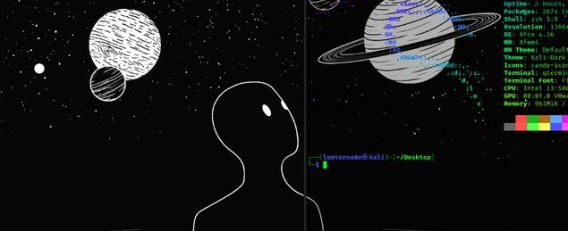

<!-- ============================================================
  SETUP: 1) Create a PUBLIC repo named exactly your GitHub username
         2) Put this file in it as README.md
         3) Find & replace  kalpeshjagtap05  with your real GitHub username
         4) Replace YOUR_LINKEDIN and YOUR_EMAIL below
============================================================ -->

<!-- Banner: swap this for your own pixel/dithered art image for the minimal look.
     Upload an image to the repo (e.g. assets/banner.png) and use:
      -->

  

<h1 align="center">Hi 👋, I'm Kalpesh Jagtap</h1>

### IT Engineering Student

<code>print("Learning. Building. Repeat.")</code>

Building clean, useful projects and getting better at it every day.

---

## 🚀 About Me

<table>
<tr>
<td width="62%" valign="top">

**Kalpesh**, here — an Information Technology engineering student who loves turning ideas into working software.

I enjoy writing clean, readable code and learning by building real projects, from small scripts to full web pages.

Currently sharpening my skills in **Python**, **Java**, and **JavaScript**, while getting stronger at **Data Structures & Algorithms** and the fundamentals of **web development**.

My goal is simple: write clean code, build things that work, and grow into a software engineer who creates systems that last.

</td>
<td width="38%" align="center" valign="middle">

<!-- Optional: add a pixel-art / dithered portrait or illustration here
      -->

</td>
</tr>
</table>

---

## 🤝 Connect

  
  
  

---

## 💻 Tech Stack

  

---

## 📊 GitHub Stats

  

  
  

---

## 📈 Activity Graph

  

---

  ⭐ Thanks for stopping by. Feel free to explore my repos!

